I am interested in how the beauty of mathematics can be experienced in visual forms and the use of geometry and abstraction to create art as well as using algorithms to design artwork. I am also interested in aesthetic mathematical figures and strive to include beauty drawings in my mathematical work. This page is a random collection of my work that will be sporadically updated. 

## Circle Packing Images

These images are created with a collection of three scripts I wrote, two in [Processing](http://processing.org) and one in Mathematica that collectively create a circle packing from an input image and output an SVG file. The final image is then produced by hand-tuning the SVG in Graphic and Pixelmator to output a PNG. 

<figure markdown>
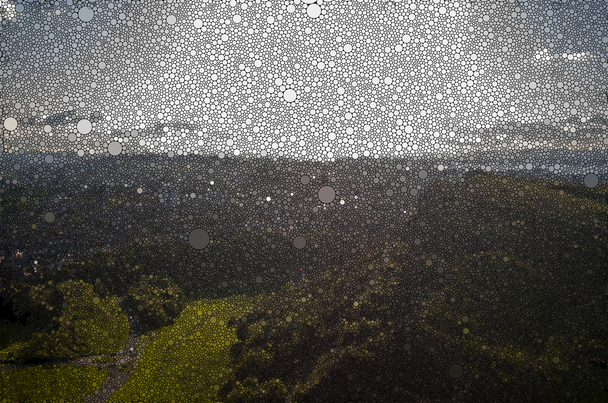
<figcaption markdown="span">
Holyrood Park, Edinburgh, UK. [Full Size (10.8MB)](images/arthurs-seat.png) 
Original image taken by Christian Fuller (JMU'20) on the JMU CS Rigidity Theory in UK study abroad program. 2019.
</figcaption>
</figure>

Below is an image I made of Bill Thurston the father of circle packing, one from a picture posted by [Keenan Crane to twitter](https://twitter.com/keenanisalive/status/1146053347646038016?s=20). I never met Thurston, but his mathematical work and attitude towards mathematical research as an essentially human endeavor continues to inspire me. I recently stumbled across his user account at [MathOverflow](https://mathoverflow.net). His last post on MathOverflow in answer to the question "What's a mathematician to do?" is [beautiful and most certainly worth your time to read](https://mathoverflow.net/questions/43690/whats-a-mathematician-to-do/44213#44213). 

<figure markdown>
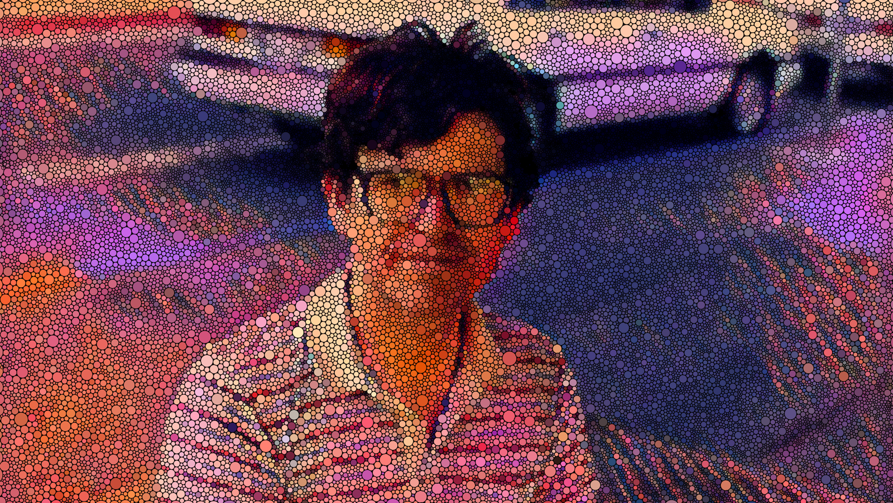
<figcaption markdown="span">
Bill Thurston. [Original image](https://opc.mfo.de/detail?photo_id=13012&would_like_to_publish=1#request) &copy; 1991 [George M. Bergman](https://math.berkeley.edu/~gbergman/). [Keenan Crane](https://www.cs.cmu.edu/~kmcrane/) [modified the image](https://twitter.com/keenanisalive/status/1146053347646038016?s=20) using deep style transfer and hand-editing. I circle packed it. [Full Size (9.6MB)](images/thurston-pic-bl.png) 
</figcaption>
</figure>

<!--figure>
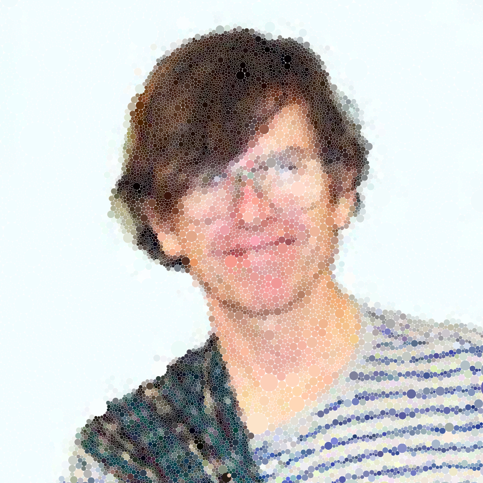
<figcaption markdown="span">
A Circle Packing of Bill Thurston's old Cornell employee ID. [Full Size (7MB)](images/thurston-pic.png) 
</figcaption>
</figure-->

## Design

<figure markdown>
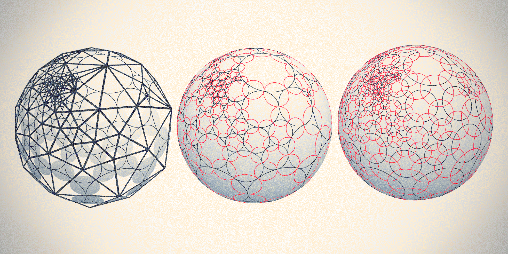
<figcaption markdown="span">
Koebe Polyhedron, Circle Packing, Inversive Distance Circle Packing 
Produced for the [2019 Summer Circle Packing Symposium](http://scps18.cs.jmu.edu). 2019.
</figcaption>
</figure>

<figure markdown>
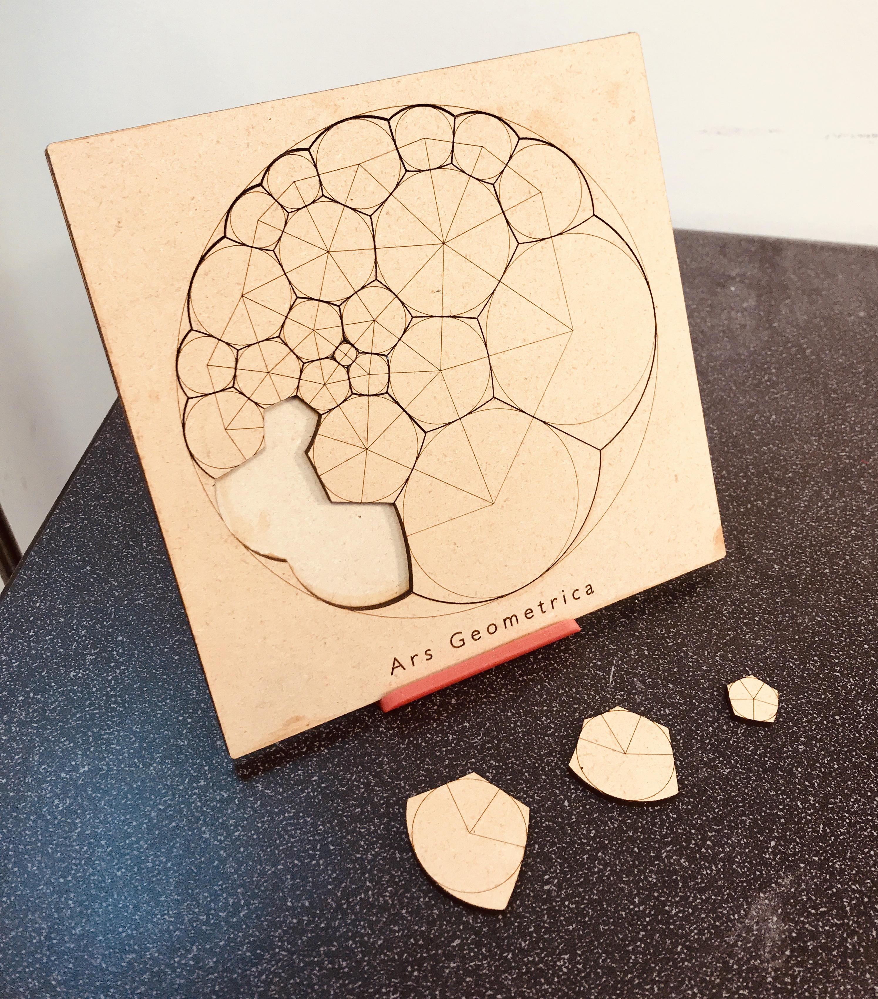
<figcaption markdown="span">
2D Bubble Puzzle. 2018. 
</figcaption>
</figure>

<figure markdown>
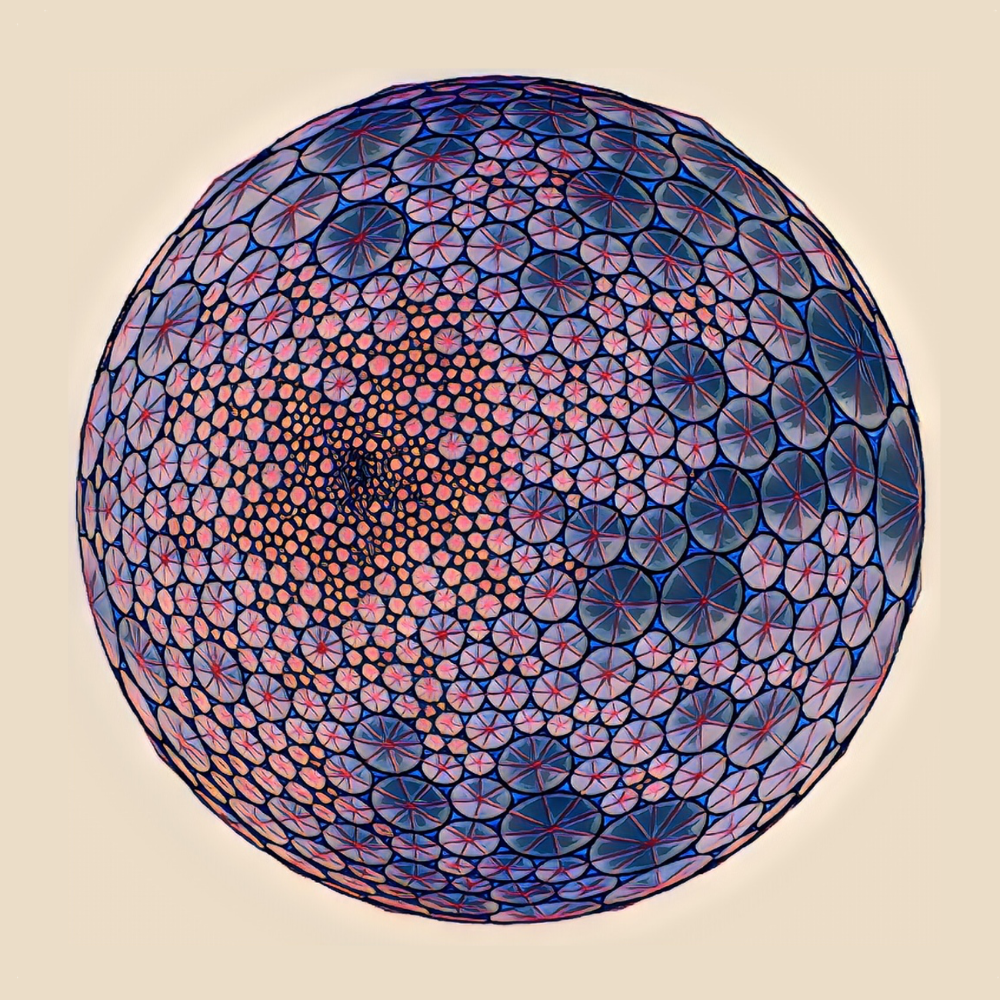
<figcaption markdown="span">
Circle Packing of the Sphere. 2017. 
</figcaption>
</figure>

<figure markdown>
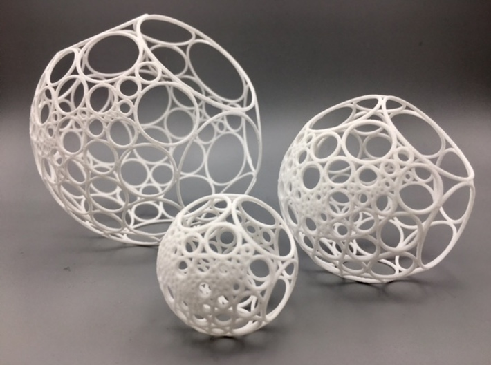
<figcaption markdown="span">
Circle packing ornaments, made in collaboration with [Laura Taalman](https://mathgrrl.com). [Print one at Shapeways.](https://www.shapeways.com/product/ZZ8WJ5HEU/bowers-circle-packing-ornament-100-circles) 2017. 
</figcaption>
</figure>

## Posters

  

    <a href="images/posters/meltdown-and-spectre.pdf">
    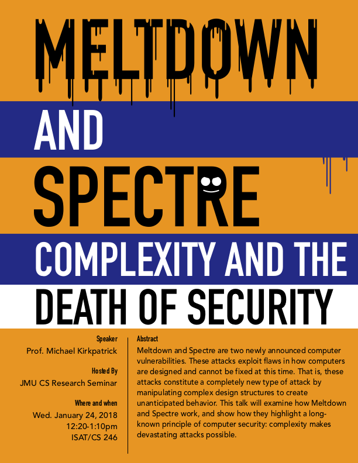
    </a>
  

  

    <a href="images/posters/rigidity-theory-audrey.pdf">
    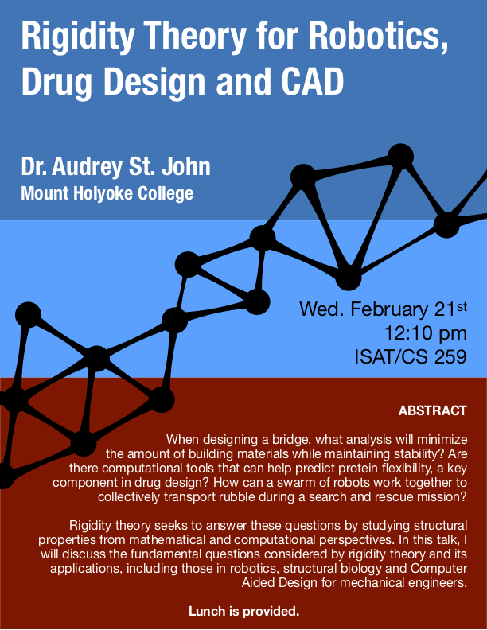
    </a>
  

  

    <a href="images/posters/laura-taalman-talk.pdf">
    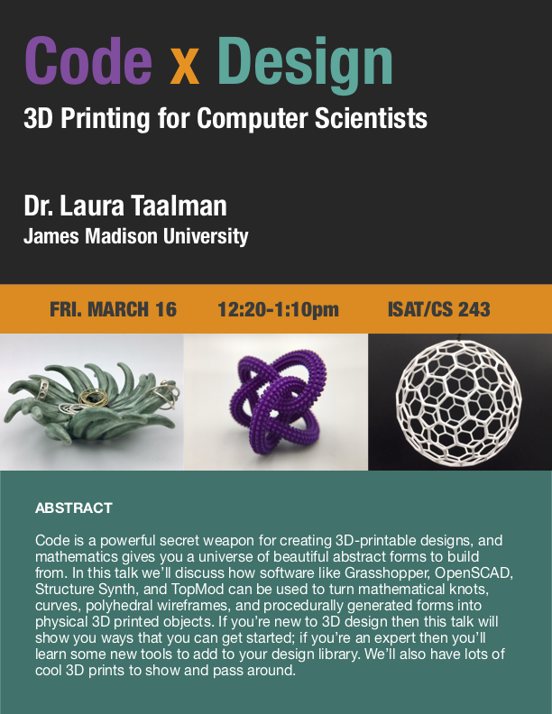
    </a>
  

  

    <a href="images/posters/scps18flyer.pdf">
    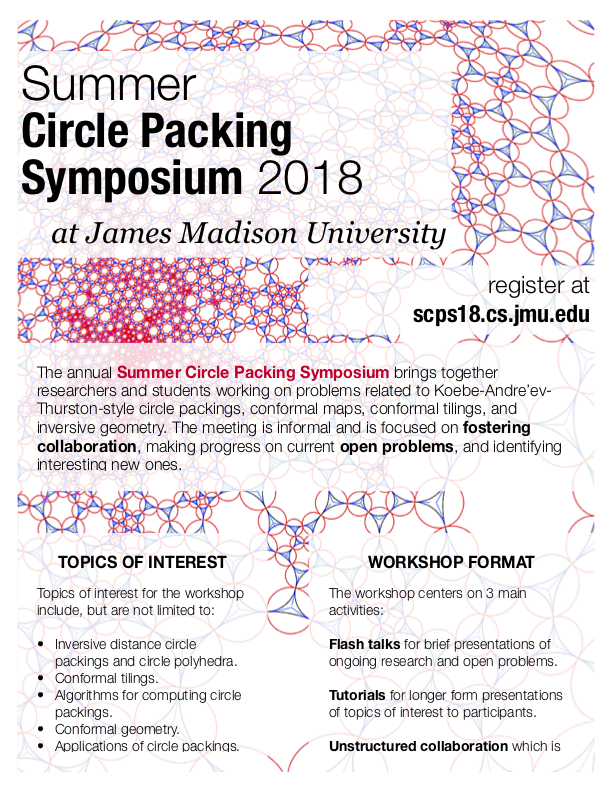
    </a>
  

