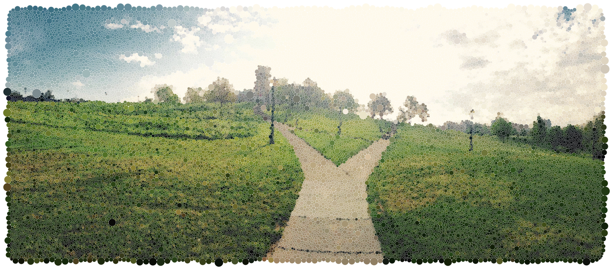

# Bio

<figure markdown>

<figcaption markdown="span">
A Circle Packing of the ISAT/CS Building. [Full Size (18MB)](images/isat-pic-4k.png) [PDF (5MB)](images/isat-pic-withborder.pdf) 
</figcaption>
</figure>

I am an associate professor of computer science at James Madison University. 

My research interests are in discrete and computational geometry, primarily problems arising from studying the rigidity of circle packings and polyhedra. 

My teaching interests are in the mathematical side of the undergraduate CS curriculum. I have taught courses in data structures, algorithms, programming languages, discrete mathematics, and computational geometry as well as programming fundamentals. 

Students interested in working with me should check out my <a href="http://arsgeometricalab.com">research lab webpage</a>. 

I am one of the CS first-year advisors. I am the organizer of the [CS Research Seminar](https://w3.cs.jmu.edu/research-talks/) talk series. 

## On the Liberal Arts and Research

I am a firm believer in the great importance of the liberal arts to the betterment of society. The role of the university in human society is to preserve the cultural deposit of knowledge that has been passed on to us, to pass it on to the next generation, and to add to it as we can, expanding our understanding of the universe and our place within it. This is why a professor's job is both teaching, which preserves and passes on knowledge, and research, which expands it.

Though we silo human knowledge into fields of inquiry, all areas of human knowledge have the Core Mission--to arrive at Truth, to seek out Goodness, and to find Beauty. Our job is to bring light to darkness, and to bring about a more just and peaceful world, a world that supports human flourishing. This core mission cannot be accomplished by any one field of human inquiry, but requires an integrated and concerted effort by us all. 

This is also why a student's job is not simply job training, as if human society has not progressed from that of the hunter-gatherer. A student's task is to acquire a broad understanding of the work of human inquiry, to appreciate how the disciplines inform each other in The Core Mission, and to go out into the world and use the knowledge they have gained to bring about a more just and peaceful world. For this reason, James Madison University is both a research institution and a liberal arts institution and as a faculty member of the computer science department I work to live fully into the role of liberal arts researcher and professor and teach my students to do the same. 

## Selected Publications

Here are a few recent publications on circle packings. More publications can be found [here](publications.html).

* (with Bradley McCoy, Dema Nasrawt, and Aidan Pawlak) "Spanning Trees Minimizing Geometric Indices." _33rd Annual Fall Workshop on Computational Geometry_ (FWCG 2026). To appear.
* (with [Philip Bowers](https://www.math.fsu.edu/~bowers/) and Carl O. R. Lutz) ["Rigidity of Koebe Polyhedra and Inversive Distance Circle Packings."](https://arxiv.org/abs/2601.22903) arXiv:2601.22903 (2026)
* ["Escher: An Engine for Exploring Hierarchical Combinatorial Tilings"](https://archive.bridgesmathart.org/2024/bridges2024-455.html#gsc.tab=0) _Proceedings of Bridges 2024: Mathematics, Art, Music, Architecture, Culture_ (2024). 
* ["A proof of the Koebe-Andre'ev-Thurston theorem via flow from tangency packings."](https://arxiv.org/abs/2007.02403) arXiv:2007.02403
* (with [Philip Bowers](https://www.math.fsu.edu/~bowers/) and Kevin Pratt) ["Almost all circle polyhedra are rigid,"](https://doi.org/10.1007/s10711-019-00438-0) Geometriae Dedicata (2019). https://doi.org/10.1007/s10711-019-00438-0
* (with [Philip Bowers](https://www.math.fsu.edu/~bowers/) and Kevin Pratt) ["Rigidity of circle polyhedra in the 2-sphere and of hyperideal polyhedra in hyperbolic 3-space"](https://www.ams.org/journals/tran/2019-371-06/S0002-9947-2018-07483-9/). _Transactions of the American Mathematical Society_. Appeared online September 25, 2018. ([AMS Online Access](https://doi.org/10.1090/tran/7483))
* (with [Philip Bowers](https://www.math.fsu.edu/~bowers/)) [Ma-Schlenker c-Octahedra in the 2-Sphere](https://link.springer.com/content/pdf/10.1007/s00454-017-9928-1.pdf). _Discrete and Computational Geometry_ (2017), DOI 10.1007/s00454-017-9928-1

## Recent Talks
* In April 2026, I gave a talk titled "Dürer's Problem and Coin Polyhedra" at the JMU CS Research Seminar.
* In Spring 2025, I gave a seminar at ICERM during the [Geometry of Materials, Packings and Rigid Frameworks](https://icerm.brown.edu/program/semester_program/sp-s25) semester program.
* In August 2023, I gave a talk titled “Koebe-Andre’ev-Thurston via Flip-and-Flow” at the [Workshop on Constraint Systems: Distance Geometry, Structured Polynomials, Matrix Completion and Kinematics](http://www.fields.utoronto.ca/activities/23-24/constraint-systems) at the Fields Institute in Toronto.
* In May 2022, I gave an invited talk at the [Workshop on Discrete Shapes](https://discreteshapes.gitlab.io/discrete-shapes/workshop_2022_Harvard/index.html) at the NSF FRG Workshop on Geometric Methods for Analyzing Discrete Shapes at Harvard University.
* In October 2020, I gave a talk titled "Obtaining Koebe-Andre’ev-Thurston packings via flow from tangency packings" to the [Topology Seminar at Florida State Mathematics](https://www.math.fsu.edu/~ballas/topology_seminar.html). 
* In November 2019, I gave a talk titled "Rigidity Results for c-Polyhedra" to the [Discrete Geometry and Combinatorics Seminar](http://pi.math.cornell.edu/~webgeo/) at Cornell University as well as a guest lecture in Bob Connelly's [Discrete Geometry, Rigidity, and Circle Packings](https://e.math.cornell.edu/classes/math7610/) course. 
* In June 2019, I gave a talk at the [Geometric Constraint Systems 2019 Workshop in Lancaster, UK](https://www.lancaster.ac.uk/maths/research/conferences/previous-conferences/geometric-constraint-systems-2019/) titled "Inversive Distance Circles Packings and Minkowski Spacetime."
* In April 2019, I gave a talk to the GRAND Seminar at George Mason University, ["Polyhedra and Inversive Distance Circle Packings."](https://cs.gmu.edu/~robotics/pmwiki.php/Main/20190426) 

## Personal

Outside of my teaching and research, I pursue a number of other interests. These include [cycling](http://svbcoalition.org), [rock climbing](https://web.archive.org/web/20210415211429/https://www.jmu.edu/recreation/_files/adventure/localclimbing.pdf), playing the violin (and fiddling). I also have a lay interest in philosophy, most recently [Thomistic metaphysics](https://www.goodreads.com/book/show/19160503-scholastic-metaphysics) and [theories of mind](https://www.goodreads.com/book/show/179744.The_Emperor_s_New_Mind). I am married and have four children, Pippin, Scout, Roo, and Teddy. I am a member of [Blessed Sacrament Catholic Church](https://www.bsccva.com) in Harrisonburg and I am the faculty sponsor for the [JMU Catholic Campus Ministry](https://jmuccm.com). 
