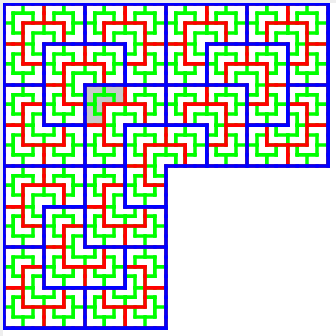
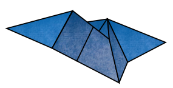

## News

* We had a great "What is CS Research?" event during this year's first [research seminar](researchtalks.html). If you missed the event, [you can still see slides from the talk](/bowersjc/files/WhatIsResearchSlides.pdf).

## Overview

The Undergraduate Research Lab is comprised of CS faculty who are currently working with or actively seeking talented undergraduate research assistants to collaborate on research projects in a variety of fields. Students gain experience in all aspects of research, while working closely with faculty members to push the boundaries of human knowledge. Projects can be anywhere from a semester long collaboration to multiple years. If you are interested in research, are thinking about graduate school, or just want to learn more about what we're up to, please contact one of the faculty members listed below.

[See Project Examples Below](#projects)

__CS Research Seminar Talks__

The CS Research Seminar Talks are biweekly talks given by faculty members and undergraduate research assistants on a variety of topics at the cutting edge of computer science research. The format is a 30-40 minute research talk with 10-20 minutes reserved for questions. All CS students are invited to attend.

* [Schedule](researchtalks.html)

#### People

##### Faculty:

* [Prof. Bernstein](https://users.cs.jmu.edu/bernstdh/)
* [Prof. Bowers](https://w3.cs.jmu.edu/bowersjc/)
* [Prof. Fox](https://users.cs.jmu.edu/foxcj/Web/)
* [Prof. Kirkpatrick](https://w3.cs.jmu.edu/kirkpams/index.shtml)
* [Prof. Lam](https://w3.cs.jmu.edu/lam2mo/)
* [Prof. Sprague](https://w3.cs.jmu.edu/spragunr/)
* [Prof. Weikle](https://w3.cs.jmu.edu/weikleda)

##### Current Students:

* Felicia Anderson
* Maddie Brower
* Diana Godja
* Andrew Jones
* Kyle Laker

##### Past Students and Alumni:

* Brittany Braswell
* Xiang Chen (JMU '18)
* Benjamin Flint (JMU '18)
* Garrett Folks (JMU '18)
* Griffin Gaskins
* Jasmyn Kelly (JMU '18)
* Patrick Kirchhoff
* Angelo Luna (JMU '18)
* Justin Magnotti (JMU '16)
* Nicole Maguire (JMU '18)
* Zamua Nasrawt (JMU '18)
* Matt Petty (JMU '17)
* Adam Slattum (JMU '18)
* Steven Young (JMU '16)
* Alexander Williams

##### 2017 REU Program 

In Summer of 2017, JMU CS ran a summer Research Experience for Undergraduates program. You can see the output of this program [here](https://jmucsreu.wordpress.com). 

* Susan Chatfield (Longwood University)
* Sarah Ciresi (Georgetown)
* Nhung Hoang (Swarthmore College)

##### Summer Research Students

* Kevin Pratt (UConn, Summer '16)

## Project Examples

_Note: Projects with a * next to the name are actively looking for new student members!_

This is only a sampling of past, current, and future research projects, and does not contain all ongoing projects. To find out
more about project availability, contact one of the faculty members listed above.

### Future Projects:

__*Evaluation of Software for Performing Principle Component Analysis (PCA)__

Principal Component Analysis (PCA) is a mathematical technique used to identify the most influential parameters in experiments with a very large number of variables. More and more frequently PCA is being used in computer workload analysis experiments in the sub-discipline of computer architecture. PCA allows an experimenter to reduce the parameters in a large experiment to a smaller number of principal components that consist of combinations of the original parameters. Experimental results can then be clustered using further mathematical analysis on the principal components and representative results for each cluster can be more closely analyzed or used in additional experiments rather than all of the original data. In this project the goal would be to document the use of and evaluate different software tools currently being used to perform PCA, with the hope of eventually contributing to an open-source example of such a tool. Students should have a strong mathematical background, be comfortable or willing to learn advanced math and scripting skills and be a reasonably competent programmer in at least Python, Java, C, or C++.

* Faculty Contact: [Prof. Weikle](https://w3.cs.jmu.edu/weikleda)

__*Automated Detection of 3D Printer Failure__

The purpose of this project is to create an automated system for detecting failure during 3D printing. Currently 3D printing technology is one-way--a computer sends commands to the printer, which then executes the commands to create a 3-dimensional object. The problem, however, is that sometimes prints fail. If a human isn't actively watching the print, then a failure can lead to a lot of wasted print time and material. The goal of this project is to develop a system that uses computer vision to maintain a reconstruction of the model as it is printed and compare the actual printed model with the desired print to detect print failures early and either correct the problem or stop the print. This project will combine aspects of computer graphics, computer vision, machine learning, and computational geometry. It is especially suitable for a student in their Junior year and would make an excellent Honors in the Major Thesis.

* Faculty Contact: [Prof. Bowers](https://w3.cs.jmu.edu/bowersjc)

__*Expanding Flynn's Taxonomy (E-Flynn)__

Flynn's Taxonomy along with terms such as data parallelism, task parallelism, instruction-level parallelism and the Berkley "13 dwarfs" have all been used to understand different types of parallelism in computer workloads. In this project the goal is to define a new taxonomy that will expand on Flynn's taxonomy and provide a comprehensive view of parallelism that will not only encompass the aforementioned versions of parallelism, but will be a teaching tool and a method of explaining performance needs of different categories of parallelism from the computer architecture/hardware. Students should have a basic understanding of computer architecture and basic programming skills, ideally including assembly language. Experience with software tools such as PIN is ideal, but not required. This work is done in conjunction with Dr. Kelly Shaw's undergraduate research at the University of Richmond.

* Faculty Contact: [Prof. Weikle](https://w3.cs.jmu.edu/weikleda)

__*Floating-point Precision in Game Engines__

Floating-point arithmetic is widely used in computing but it is frequently misunderstood and misused. Among other issues, developers must choose between 32-bit single precision (often called simply "float") and 64-bit "double" precision, and there is a tradeoff between the accuracy of double precision and the speed of single precision.

In this project, we will explore the approaches taken by various game and graphics engines with regards to floating-point precision levels. We will perform experiments to demonstrate the impact of precision choice on game behavior and performance, and we will explore the use of "mixed" precision (using both single- and double-precision) in game and graphics code.

The ideal candidate for this project will have some programming experience in C++, Java, or Python. Experience with game or graphics development is a plus, but not required.

* Faculty Contact: [Prof. Lam](https://w3.cs.jmu.edu/lam2mo/)

__*Floating-Point Visualization__

The details of floating-point number representation often confuse
students and software developers. Often this is because of fundamental
misunderstandings about the nature of the floating-point number line and
floating-point arithmetic. The goal of this project is to develop more
effective visualizations to illustrate the advantages and pitfalls of
floating-point representation.

* Faculty Contact: [Prof. Lam](https://w3.cs.jmu.edu/lam2mo/)

__Humanitarian Free and Open-Source Software Projects (HFOSS)__

Open source software projects are an excellent way of learning how large software projects are developed, documented and maintained. Mousetrap, Ushahidi, and OpenMRS are all examples of such projects that have academic groups involved in contributing and maintaining them. Initial investigation in this project would be to contribute to Mousetrap (a GNOME effort to improve computer accessibility by allowing mouse-control via the head movement observed by a camera), but involvement in another HFOSS project would be considered based on significant student interest. No experience required as contributions can be made at many levels, including web-site maintenance, documentation, bug verification, code bug repair, etc. Strong written communication skills beneficial.

* Faculty Contact: [Prof. Weikle](https://w3.cs.jmu.edu/weikleda)

__*Mixed-precision Analysis of Scientific Applications__

As scientific computing continues to scale, it is important to use floating-point arithmetic effectively. Recently, there has been an increased level of interest in "mixed" precision: using both single- and double-precision arithmetic in the same program, or even in the same routine. Mixed precision routines can increase performance without compromising accuracy. Various tools exist to help automate the process of converting a scientific application to use mixed precision.

In this project, we will select one or more actual scientific applications and analyze them using several tools. We will perform experiments to explore application behavior and performance as we vary the floating-point precision, and we will attempt to build a mixed-precision version of each application that exhibits a level of accuracy similar to the original.

The ideal candidate for this project will have extensive experience programming in C or C++ on a Unix-based system. Experience with parallel and distributed programming in OpenMP and/or MPI is a plus, but not required. In addition, experience with large application frameworks or tool-based analysis and debugging is a plus, but not required.

* Faculty Contact: [Prof. Lam](https://w3.cs.jmu.edu/lam2mo/)

### Current Projects:

__*Advanced Algorithms for GPS Navigation Systems__

GPS navigation systems have been commercialized for many years and, at
this point, are ubiquitous. While many advances have been made since
they were first introduced, most of the improvements have involved the
data and/or the platform, not the underlying algorithms. This project is
considering both improved algorithms for solving the "classical"
problems (e.g., path finding, map matching) and new algorithms for
solving problems that have been ignored in the past (e.g., finding
alternative paths, finding constrained paths).

* Faculty Contact: [Prof. Bernstein](https://users.cs.jmu.edu/bernstdh/)

__Automated Exam Management System__

We are developing a novel educational software system for managing and
producing academic exams and tests. The system provides a way to store
exam questions and allows faculty members to create scriptable
questions, allowing exams to be regenerated for each semester with new
parameters. This system will enable easier standardization of exam
questions across sections. It will also provide a foundation for
future education research, allowing correlations between question
types and student performance as well as enabling the use of machine
learning techniques to optimize exam coverage.

* Faculty Contact: [Prof. Lam](https://w3.cs.jmu.edu/lam2mo/)

<!-- __*Circle Packings and Polyhedra__

A _circle packing_ is a pattern of circles with a prescribed tangency pattern. Such patterns are practically useful -->

__*Escher: A programming language for subdivision tilings__

In this project we are developing a programming language for describing a periodic
tilings and a suite of tools for investigating their properties. Subdivision
tilings are used in creating aperiodic tilings, which are tilings of the plane
made from a finite set of building blocks that exhibit infinite variability
in their patterns. Such tilings are used to model certain natural phenomena
observed in quantum physics, and computing properties of aperiodic tilings has
become its own field of pure mathematics. The goal of this project is to create
a software tool that supports researchers working on problems related to aperiodic
tilings and also to aid in the discovery of new tilings.

* Faculty Contact: [Prof. Bowers](https://w3.cs.jmu.edu/bowersjc/)

__*Origami Design__

In this project we are developing new techniques for origami design. A basic origami design problem specifies a set of constraints, for instance some characteristics of a final 3D shape, and asks how can a sheet of paper be folded in such a way that the constraints are satisfied? More than just folding paper, origami design has found its way into a variety of applications, from satellite design to nano-material manufacturing to medical apparatus design (to name just a few).

The ideal candidate for this project will have experience programming in Java as well as some familiarity with linear algebra. Experience with graphics programming using OpenGL is a plus, but is not required.

* Faculty Contact: [Prof. Bowers](https://w3.cs.jmu.edu/bowersjc/)

__Protein Folding via Rigidity Analysis__

In this project we are collaborating with the [Linkage Lab](http://linkage.cs.umass.edu), a joint lab at Smith College and the University of Massachusetts, Amherst, on developing software and techniques for applying rigidity theory to the protein folding problem. The problem is this: given a protein, determine what motions it is capable of following. Understanding this problem is integral to understanding how proteins work. As the biologists say: _form equals function_! A variety of methods are used to analyze proteins. Rigidity theory is a branch of mathematics that grew out of structural engineering for analyzing the rigidity/flexibility of structures (such as buildings and bridges).

* Faculty Contact: [Prof. Bowers](https://w3.cs.jmu.edu/bowersjc/)

__Unum Arithmetic__

For decades, floating-point arithmetic has been the predominant system
for real-numbered computation in digital computers. However, this
system has many fundamental issues, including rounding error,
cancellation, and underflow. Recently, John Gustafson
([http://www.johngustafson.net/](http://www.johngustafson.net/)) proposed a new way to represent real
numbers using a new format he calls the "unum." In his book "The End
of Error," he discusses this format and provides an implementation in
Mathematica. However, to our knowledge there is currently no concrete
implementation of this idea in a low-level language, which would allow
for more efficient testing. The goal of this project is to implement
unum arithmetic in Rust, a systems programming language that
emphasizes both speed and safety.

Faculty Contact: [Prof. Lam](https://w3.cs.jmu.edu/lam2mo/)
