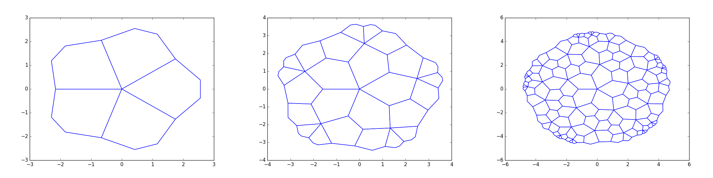

## Coin Unfolding

<figure markdown>

<figcaption markdown="span">
A screenshot of the Coin Unfolding App.
</figcaption>
</figure>

Coin Unfold is for exploring polyhedral coin unfoldings. 

* [Coin Unfolding](https://johncbowers.github.io/coin_unfold/)
* [GitHub](https://github.com/johncbowers/coin_unfold)

## Koebe-Lib

<figure markdown>

<figcaption markdown="span">
A screenshot of the SphericalSketch app of Koebe-Lib.
</figcaption>
</figure>

Koebe-Lib is a library for investigating inversive geometry of circles. It has facilities for representing circles / disks one the 2-sphere as well as in other geometries such as Euclidean and Oriented Projective. It includes Ken Stephenson's [CirclePack](http://www.circlepack.com) as a dependency for performing circle packing. The code is written in Kotlin and can be used as a Kotlin library. We also have a small application included called SphericalSketch which displays the 2-sphere and a python coding window and allows figures to be constructed using python. 

* __Collaborators:__ Maddie Brower (JMU), Sarah Ciresi (Georgetown'18), Quincy Mast (JMU'18)
* [Koebe-Lib GitHub](https://github.com/johncbowers/KoebeLib)

## Escher

<figure markdown>

<figcaption markdown="span">
Three levels of the twisted pentagonal subdivision as output by Escher.
</figcaption>
</figure>

Escher is a programming language for coding conformal subdivision tilings. Currently, Escher's code resides within Koebe-Lib though it should probably eventually fork off into its own project. 

* __Collaborators:__ Angelo Luna

## Other

* [KINARI](http://kinari.cs.umass.edu/Site/index.html). I collaborate with [Ileana Streinu](http://cs.smith.edu/~streinu/) on the protein rigidity analysis software Kinari. 
* [JMU CS Interactive Hall Display](https://github.com/JMU-CS/Interactive-Hall-Display). I coded the initial framework for the CS department's interactive hall display. The goal is to have students submit additional visualizations and games. 
* [JMU Freshman Advising Schedule Generator](https://w3.cs.jmu.edu/bowersjc/fya/schedules/). A schedule generator for JMU Freshman Advisors that allows advisors to generate advisee schedules for Summer Springboard with useful information like: it takes more than 15 minutes to walk from the Physics/Chemistry building to Memorial.  
* [JMU CS Core Course Connections](https://w3.cs.jmu.edu/bowersjc/chord_graph/). A visualization of the connections between various CS courses by topic coverage. 