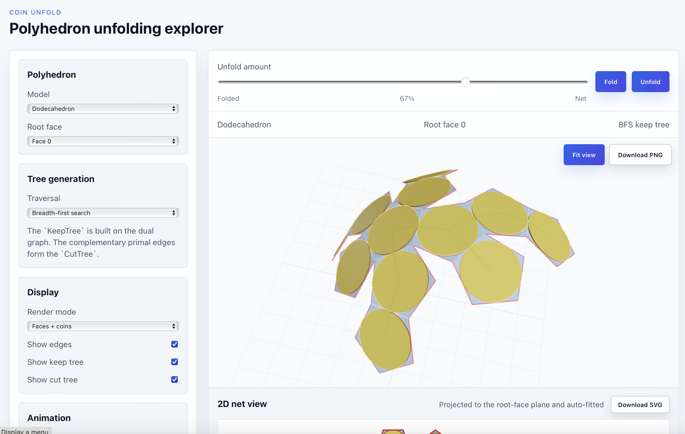
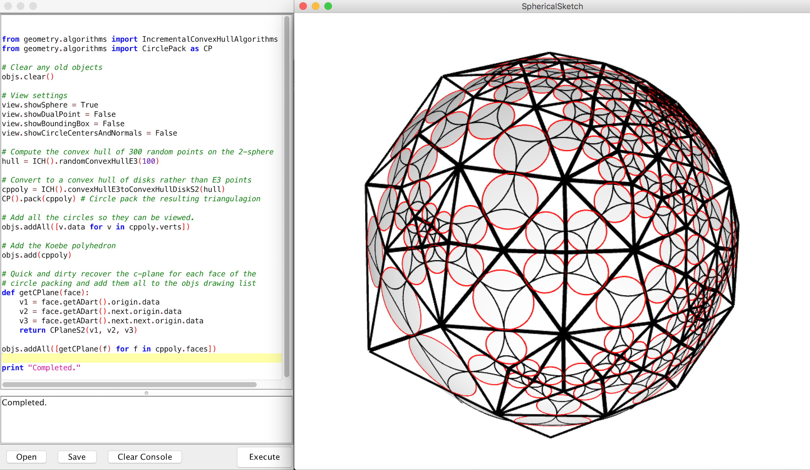
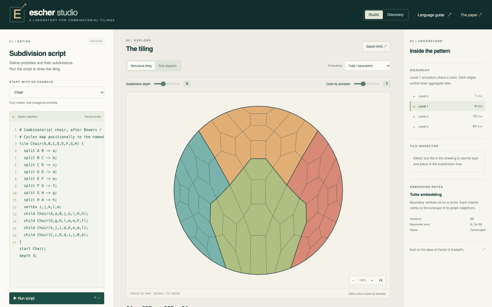

## Coin Unfolding

<figure markdown>

<figcaption markdown="span">
A screenshot of the Coin Unfolding App.
</figcaption>
</figure>

Coin Unfold is for exploring polyhedral coin unfoldings. 

* [Coin Unfolding](https://johncbowers.github.io/coin_unfold/)
* [GitHub](https://github.com/johncbowers/coin_unfold)

## Koebe-Lib

<figure markdown>

<figcaption markdown="span">
A screenshot of the SphericalSketch app of Koebe-Lib.
</figcaption>
</figure>

Koebe-Lib is a library for investigating inversive geometry of circles. It has facilities for representing circles / disks one the 2-sphere as well as in other geometries such as Euclidean and Oriented Projective. It includes Ken Stephenson's [CirclePack](http://www.circlepack.com) as a dependency for performing circle packing. The code is written in Kotlin and can be used as a Kotlin library. We also have a small application included called SphericalSketch which displays the 2-sphere and a python coding window and allows figures to be constructed using python. 

* __Collaborators:__ Maddie Brower (JMU), Sarah Ciresi (Georgetown'18), Quincy Mast (JMU'18)
* [Koebe-Lib GitHub](https://github.com/johncbowers/KoebeLib)

## KoebePy

KoebePy is a Python library for inversive geometry and circle packing on the Riemann sphere, with sample Jupyter notebooks. In 2025 I built a browser-based front end for it, so that students in the CS Rigidity Theory in the UK program could run live, interactive 2D and 3D constructions in lab and homework.

* [KoebePy GitHub](https://github.com/johncbowers/koebepy)

## Escher Studio

<figure markdown>

<figcaption markdown="span">
Three levels of the combinatorial chair tiling in Escher Studio.
</figcaption>
</figure>

Escher Studio is a browser-based editor and discovery workspace for hierarchical combinatorial tilings. You write a subdivision rule as a short script, then explore the recursive tiling it generates: trace a tile's ancestry, color by hierarchy level, and embed it with a Tutte (barycentric) embedding or an experimental circle packing. It builds on the ideas of ["Escher: An Engine for Exploring Hierarchical Combinatorial Tilings"](https://archive.bridgesmathart.org/2024/bridges2024-455.html) (Bridges 2024).

* [Escher Studio](https://johncbowers.github.io/EscherStudio/)
* [GitHub](https://github.com/johncbowers/EscherStudio)

## Flip & Flow

Flip & Flow is a browser-based circle packing puzzle on the sphere. Each circle stands for a vertex of a triangulation and is colored by its degree; clicking an edge flips it, and the packing flows continuously to the new one. The goal is to reach a target degree pattern, such as the buckyball's. It is based on Ken Stephenson's flip puzzle in CirclePack, and the motion is flip-and-flow (Connelly and Gortler, 2021; Bowers, 2020).

* [Flip & Flow](https://johncbowers.github.io/flipflow-puzzle/)
* [GitHub](https://github.com/johncbowers/flipflow-puzzle)

## Other

* [KINARI](https://web.archive.org/web/20191226011820/http://kinari.cs.umass.edu:80/Site/index.html). I collaborate with [Ileana Streinu](http://cs.smith.edu/~streinu/) on the protein rigidity analysis software Kinari. 
* [JMU CS Interactive Hall Display](https://github.com/JMU-CS/Interactive-Hall-Display). I coded the initial framework for the CS department's interactive hall display. The goal is to have students submit additional visualizations and games. 
* [JMU Freshman Advising Schedule Generator](https://w3.cs.jmu.edu/bowersjc/fya/schedules/). A schedule generator for JMU Freshman Advisors that allows advisors to generate advisee schedules for Summer Springboard with useful information like: it takes more than 15 minutes to walk from the Physics/Chemistry building to Memorial.  
* [JMU CS Core Course Connections](https://w3.cs.jmu.edu/bowersjc/chord_graph/). A visualization of the connections between various CS courses by topic coverage. 